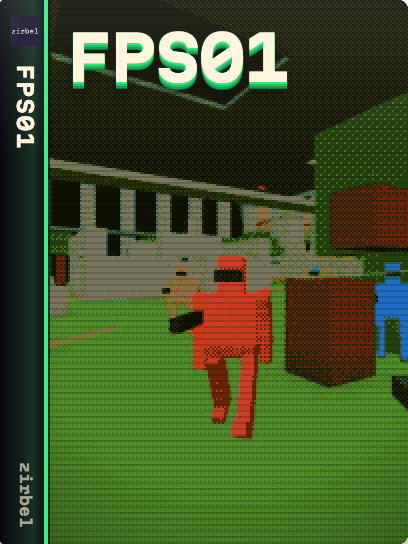

# fps01



A destructible arena shooter for up to 16 players, with six weapons, deathmatch and capture the flag.
Play with mouse and keyboard, touch or gamepad.

## Run

Use Node.js 24 or newer and npm.

```sh
npm ci --ignore-scripts
npm start                  # LAN server: http://localhost:7777
```

Other players open the host's LAN address. Set `PORT` to change the port.
`npm run zirbel` builds `dist/zirbel/fps01` for a Zirbel host.

## Develop

```sh
npm run verify             # formatting, types, boundaries, tests and build
npm run format             # format maintained files
```

Tune rules and maps in `data/`; each block has a schema. Revisions apply at the next round.
Read [AGENTS.md](AGENTS.md) before changing code.

## Docs

- [Controls](docs/CONTROLS.md): keyboard, touch and gamepad.
- [Development](docs/DEVELOPMENT.md): ownership, authority and verification.
- [Shared standard](docs/engineering/STANDARD.md): language, tools and compiler contracts.
- [Contributing](CONTRIBUTING.md) and [security](SECURITY.md): changes and vulnerability reporting.
- [Public source snapshot](docs/PUBLIC_READINESS.md): standalone setup and history boundary.

## License

Code: [MIT](LICENSE). Third-party work keeps its own license.
[Asset catalog](assets/assets.json) and [sound credits](public/audio.html) retain creators, sources and licenses.
